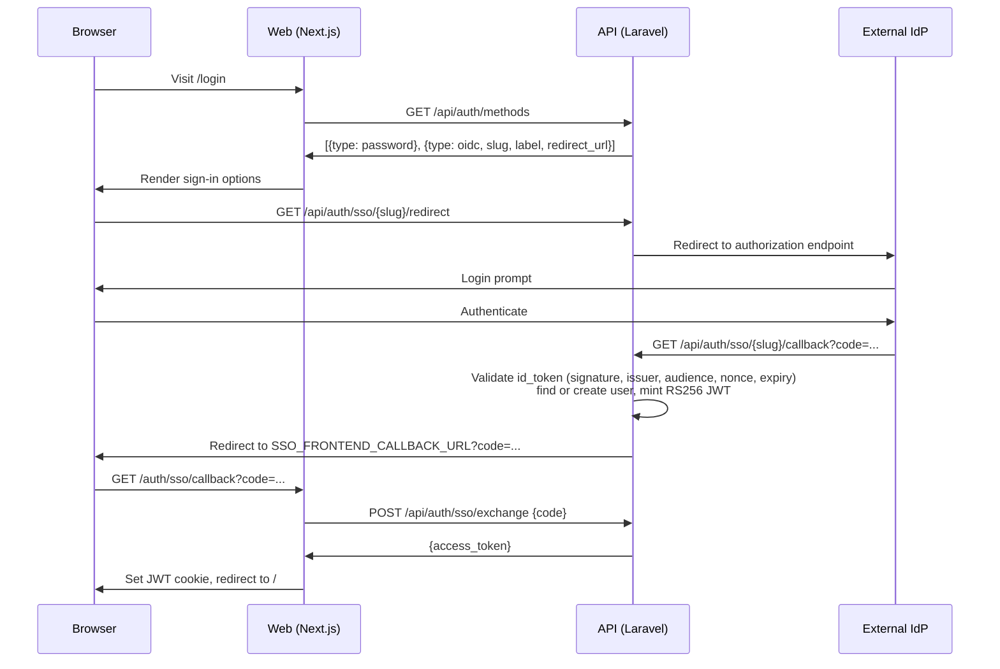

# Connecting an identity provider

Optional. Your deployment can hand the front door to an external identity provider while password login carries on working alongside it. SSO is an additional way in, not a replacement.

This is the first of three steps: **connect a provider** → [map its claim values](claim-mapping.md) → [decide how far to trust them](access-control-policy.md).

## What we support

**Keycloak** is tested end to end and has a [full walkthrough](examples/keycloak.md). Start there if you have no strong preference.

Any OIDC provider should work if it offers:

- Authorisation code flow with PKCE
- A confidential client that accepts `client_secret_post`
- A discovery document at `{issuer}/.well-known/openid-configuration`
- `sub` and `email` in the ID token

!!! info "Entra ID and Google do not work yet"
    Both publish OIDC endpoints across more than one hostname, which the API currently rejects. Work is tracked in [#350](https://github.com/HDRUK/cohort-discovery-service-api/issues/350).

This is a community project, and Keycloak is simply the provider we happened to test first. If you get another one working, please open a pull request with a walkthrough — or an issue if you hit something that needs a code change.

---

## How the flow works

The API brokers the whole exchange. The browser never talks to the IdP's token endpoint, and the web app never holds an IdP client secret.



The handoff code is single-use and short-lived — the real access token never rides in a URL.

### Routes

| Route | Purpose |
|---|---|
| `GET /api/auth/methods` | What the login page renders: password, and one entry per enabled provider |
| `GET /api/auth/sso/providers` | Enabled providers only |
| `GET /api/auth/sso/{slug}/redirect` | Start a login |
| `GET /api/auth/sso/{slug}/callback` | IdP returns here |
| `POST /api/auth/sso/exchange` | Web swaps the handoff code for the access token |
| `GET /api/auth/sso/{slug}/logout` | RP-initiated logout |

---

## Provider configuration

`config/sso.php` holds a `providers` array keyed by slug. The slug appears in every SSO URL and in the callback you register with the IdP. One slot ships out of the box, `default`, wired to `SSO_DEFAULT_*`:

```php
'providers' => [
    'default' => [
        'enabled' => (bool) env('SSO_DEFAULT_ENABLED', false),
        'label' => env('SSO_DEFAULT_LABEL', 'Single Sign-On'),
        'issuer' => env('SSO_DEFAULT_ISSUER'),
        'discovery_url' => env('SSO_DEFAULT_DISCOVERY_URL'),
        'client_id' => env('SSO_DEFAULT_CLIENT_ID'),
        'client_secret' => env('SSO_DEFAULT_CLIENT_SECRET'),
        'scopes' => env('SSO_DEFAULT_SCOPES', 'openid profile email'),
        'redirect_uri' => env('SSO_DEFAULT_REDIRECT_URI'),

        'claim_mapping' => [
            'workgroups_claim' => env('SSO_DEFAULT_WORKGROUPS_CLAIM', 'eduperson_entitlement'),
            'roles_claim' => env('SSO_DEFAULT_ROLES_CLAIM'),
            'custodians_claim' => env('SSO_DEFAULT_CUSTODIANS_CLAIM'),
        ],
    ],
],
```

Every variable in that block is listed in [SSO environment variables](reference/sso-environment-variables.md). Each provider needs its callback URL registered at the IdP:

```
https://api.example.org/api/auth/sso/default/callback
```

Adding a second provider means adding a slot to this file, not just setting more variables — see [Running more than one provider](reference/multiple-providers.md). Because `config/sso.php` lives in the upstream repo, that edit needs [carrying across upgrades](carrying-changes.md).

---

## Password login

```dotenv
AUTH_PASSWORD_LOGIN_ENABLED=true
```

Setting this to `false` is only honoured once SSO actually works — standalone mode, `SSO_ENABLED`, a frontend callback URL and at least one enabled provider. If any of those is missing, password login stays on regardless of the flag, so a misconfigured IdP cannot lock everyone out.

## Logout

The API discovers the IdP's `end_session_endpoint` and redirects there so the IdP session ends too. If anything about that fails it falls back to a plain redirect to the login page.

!!! warning "Register the post-logout URL at the IdP too"
    `post_logout_redirect_uri` is `SSO_FRONTEND_LOGIN_URL`, or the callback URL's origin plus `/login`. That is a *different* URL from the callback, and most IdPs validate it against a separate allow-list. If logout bounces off an "invalid redirect URI" error, that list is why.

---

Logins that fail are listed in [When a login fails](reference/login-errors.md). Once users are signing in, the admin Users view shows each one's linked identities, roles and workgroups — read-only, because assignment is config-driven on the API side.
