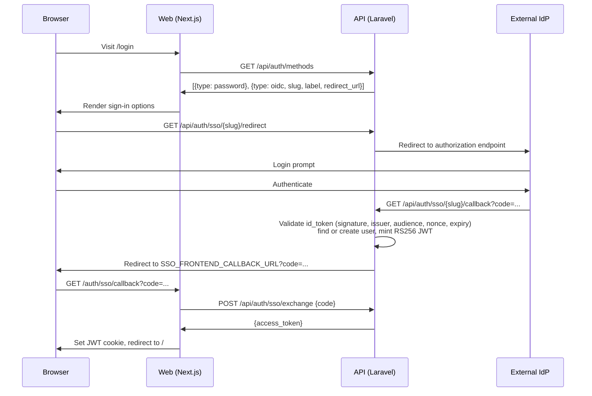

# Connecting an identity provider

Optional. Your deployment can hand the front door to an external identity provider — Keycloak, your institution's own IdP — while password login carries on working alongside it. SSO is an additional way in, not a replacement.

This is the first of three steps: **connect a provider** → [map its claim values](claim-mapping.md) → [decide how far to trust them](access-control-policy.md).

Worked examples: [Keycloak](examples/keycloak.md) (verified) · [Microsoft Entra ID](examples/entra-id.md) (currently blocked by a platform limitation).

| If you need | Go to |
|---|---|
| Every `SSO_*` variable and its default | [SSO environment variables](reference/sso-environment-variables.md) |
| A second identity provider | [Running more than one provider](reference/multiple-providers.md) |
| A login that fails with `?error=<code>` | [When a login fails](reference/login-errors.md) |

---

## Will my IdP work?

The API is a fairly strict relying party. Check these before committing to a provider — most institutional and self-hosted IdPs satisfy all of them, but a few hosted ones do not.

| Requirement | Detail |
|---|---|
| Authorisation code flow with PKCE (S256) | The only flow the API drives. No implicit, no hybrid, no device code |
| Confidential client | The API holds a client secret and sends it at the token endpoint |
| **`client_secret_post`** | The secret goes in the POST body. The API sends no HTTP Basic header and does not read `token_endpoint_auth_methods_supported`, so an IdP that only accepts `client_secret_basic` or `private_key_jwt` will not work |
| A discovery document | `{issuer}/.well-known/openid-configuration`, advertising at least `authorization_endpoint`, `token_endpoint` and `jwks_uri` |
| An `issuer` that matches exactly | The document's own `issuer`, and the `iss` claim in every token, must be byte-identical to the configured issuer |
| **Every endpoint on the issuer's origin** | See [the same-origin rule](#the-same-origin-rule) below — this is the one that rules providers out |
| JWKS entries that declare `alg` | RSA, EC and OKP keys are all parsed, but `RS256` is only *assumed* for an entry that omits `alg`. An EC key published without `alg` is misread as RSA and every login fails |
| `sub`, `email` and a reflected `nonce` in the ID token | `sub` and `nonce` are hard requirements. Without `email` the API can neither link nor create an account |
| Flat, top-level claim names | A nested claim is never read — see [How claims are read](#how-claims-are-read) |

### The same-origin rule

Every URL the API takes from the discovery document must share **scheme, host and port** with the issuer. Five endpoints are checked, not just the ones used during login:

```php
foreach (['authorization_endpoint', 'token_endpoint', 'jwks_uri', 'userinfo_endpoint', 'end_session_endpoint'] as $endpoint) {
```

The discovery document arrives over the network, so every URL in it is treated as untrusted: without this check a hostile or compromised document could point `jwks_uri` at an internal address and have the API fetch it, or at a host whose signing keys the attacker controls.

The check runs when the document is first read, which is during `/redirect` — so a provider that fails it fails at the *start* of the login, with `provider_not_configured`, before the user ever reaches the IdP.

!!! warning "Providers this rules out"
    **Google** splits its OIDC endpoints across three hosts. **Microsoft Entra ID** serves `userinfo_endpoint` from `https://graph.microsoft.com/oidc/userinfo`, a different host from its `login.microsoftonline.com` issuer — so Entra is currently blocked too, even though the endpoints the login actually uses are all on the issuer's origin. See the [Entra ID example](examples/entra-id.md) for the detail.

    Keycloak and most institutional or self-hosted IdPs keep everything on one origin and satisfy the rule.

---

## How the flow works

The API brokers the whole exchange. The browser never talks to the IdP's token endpoint, and the web app never holds an IdP client secret.



The handoff code is single-use and short-lived — the real access token never rides in a URL.

### Routes

| Route | Purpose |
|---|---|
| `GET /api/auth/methods` | What the login page renders: password, and one entry per enabled provider |
| `GET /api/auth/sso/providers` | Enabled providers only |
| `GET /api/auth/sso/{slug}/redirect` | Start a login |
| `GET /api/auth/sso/{slug}/callback` | IdP returns here |
| `POST /api/auth/sso/exchange` | Web swaps the handoff code for the access token |
| `GET /api/auth/sso/{slug}/logout` | RP-initiated logout |

`/auth/methods` and `/auth/sso/providers` carry no throttle; every other route above does. In integrated mode every `/auth/sso/*` route 404s.

## Account resolution

The `(provider, sub)` pair is the identity. Email is a hint, not proof.

| Situation | What happens |
|---|---|
| Known `(provider, sub)` | Logged in, `last_login_at` updated, name refreshed if changed |
| No email in the token | Rejected — cannot link or provision |
| Email matches a local account, **verified** | Identity linked to that account |
| Email matches a local account, **not verified** | Rejected as a possible account takeover |
| No matching account | Created on the spot (JIT), with local defaults |

The verified check is strict:

```php
emailVerified: ($claims['email_verified'] ?? false) === true,
```

Absent reads as `false`, and so does the string `"true"`. It only applies when linking to an account that already exists — JIT creation does not need it.

## Provider configuration

`config/sso.php` holds a `providers` array keyed by slug. The slug appears in every SSO URL and in the callback you register with the IdP. One slot ships out of the box, `default`, wired to `SSO_DEFAULT_*`.

Adding a second provider is a config-file change, not just an env one:

```php
'providers' => [
    'default' => [
        'enabled' => (bool) env('SSO_DEFAULT_ENABLED', false),
        'label' => env('SSO_DEFAULT_LABEL', 'Single Sign-On'),
        'issuer' => env('SSO_DEFAULT_ISSUER'),
        'discovery_url' => env('SSO_DEFAULT_DISCOVERY_URL'),
        'client_id' => env('SSO_DEFAULT_CLIENT_ID'),
        'client_secret' => env('SSO_DEFAULT_CLIENT_SECRET'),
        'scopes' => env('SSO_DEFAULT_SCOPES', 'openid profile email'),
        'redirect_uri' => env('SSO_DEFAULT_REDIRECT_URI'),

        'claim_mapping' => [
            'workgroups_claim' => env('SSO_DEFAULT_WORKGROUPS_CLAIM', 'eduperson_entitlement'),
            'roles_claim' => env('SSO_DEFAULT_ROLES_CLAIM'),
            'custodians_claim' => env('SSO_DEFAULT_CUSTODIANS_CLAIM'),
        ],
    ],

    'keycloak' => [
        'enabled' => (bool) env('SSO_KEYCLOAK_ENABLED', false),
        'label' => env('SSO_KEYCLOAK_LABEL', 'Institutional login'),
        'issuer' => env('SSO_KEYCLOAK_ISSUER'),
        'discovery_url' => env('SSO_KEYCLOAK_DISCOVERY_URL'),
        'client_id' => env('SSO_KEYCLOAK_CLIENT_ID'),
        'client_secret' => env('SSO_KEYCLOAK_CLIENT_SECRET'),
        'scopes' => env('SSO_KEYCLOAK_SCOPES', 'openid profile email'),
        'redirect_uri' => env('SSO_KEYCLOAK_REDIRECT_URI'),

        'claim_mapping' => [
            'workgroups_claim' => env('SSO_KEYCLOAK_WORKGROUPS_CLAIM', 'groups'),
            'roles_claim' => env('SSO_KEYCLOAK_ROLES_CLAIM', 'roles'),
            'custodians_claim' => env('SSO_KEYCLOAK_CUSTODIANS_CLAIM'),
        ],
    ],
],
```

Each provider gets its own callback URL, which must be registered at the IdP:

```
https://api.example.org/api/auth/sso/default/callback
https://api.example.org/api/auth/sso/keycloak/callback
```

`config/sso.php` lives inside the upstream repo, so a deployment that adds a provider has the same "how do I keep this across upgrades" problem as the other editable files — see [Carrying changes across upgrades](carrying-changes.md).

The web app renders one button per provider the API reports, with an icon matched on slug (`src/utils/ssoProviders.ts`): Google, Microsoft/Azure, Apple, GitHub, LinkedIn, Facebook and X get their own; Keycloak gets a shield; anything else falls back to a key. An icon existing does not imply the protocol works — Google and Entra ID both have icons and both currently fail [the same-origin rule](#the-same-origin-rule).

### Reaching the issuer

The issuer is not just an identifier — the API fetches it, and it constrains every other URL. That makes one requirement easy to miss:

!!! danger "The issuer URL must resolve from the browser *and* from the API container"
    `SSO_DEFAULT_ISSUER` is compared byte-for-byte against the `iss` claim, and every discovered endpoint must sit on its origin. So the same URL has to work in two places at once: the browser follows it to the login prompt, and the API fetches discovery, JWKS and the token endpoint from it server-side.

    On a host-run development setup `http://localhost:8080/realms/...` satisfies both. Under Docker, Tilt or Kubernetes it does not — the API container cannot reach the browser's `localhost`, and switching the issuer to an internal name such as `http://keycloak:8080/...` breaks the browser redirect and the `iss` match instead.

    `SSO_DEFAULT_DISCOVERY_URL` is only a partial escape hatch. It lets you fetch the *document* from an internal address, but the token and JWKS URLs are read out of that document and will still be the public ones, so the API must be able to reach them anyway.

    The fix is to give the IdP one externally-valid URL and make it resolvable from inside the cluster too — for Keycloak, `KC_HOSTNAME` plus matching DNS or a host alias. See the [Keycloak example](examples/keycloak.md).

## How claims are read

Claim names must be **flat, top-level keys**. A nested claim is not read, which matters because some IdPs default to a nested name — Keycloak's `realm_access.roles` being the common one.

```php
$raw = $claims[$claimName] ?? null;
```

| Claim value | Read as |
|---|---|
| Absent | `null` — "the IdP has no opinion", nothing is changed |
| `["a", "b"]` | Those two values |
| `"a"` | A single value |
| `"[\"a\",\"b\"]"` | Decoded, then those two values |
| `[]` | Present but empty — **clears** the relation under an authoritative sync |
| `[{...}]` | Objects are filtered out, leaving `[]` — takes the **destructive** branch |

Each subject reads its own independently-named claim, so one IdP can feed all three from different claims, or feed two of them from the same claim.

Mapping claim values onto local workgroups and roles happens in `config/claimsaccesscontrol.php`, which you are expected to edit — that is the next step, [Mapping claims to the platform](claim-mapping.md).

## Password login interlock

```dotenv
AUTH_PASSWORD_LOGIN_ENABLED=true
```

Setting this to `false` is only honoured once SSO is actually usable:

```php
public function passwordEnabled(): bool
{
    return config('auth.password_login.enabled', true) || ! $this->ssoAvailable();
}

public function ssoAvailable(): bool
{
    return ApplicationMode::isStandalone()
        && (bool) config('sso.enabled')
        && (bool) config('sso.frontend_callback_url')
        && OidcProviderConfig::enabledProviders() !== [];
}
```

If any of those four conditions fails, password login stays on regardless of the flag — a misconfigured IdP cannot lock every account out.

## Logout

The API discovers the IdP's `end_session_endpoint` and redirects there with `client_id`, a `post_logout_redirect_uri` and an `id_token_hint`, so the IdP session ends too (RP-initiated logout). If anything about that fails it falls back to a plain redirect to the login page.

The `id_token_hint` reaches the API as a `?ticket=` parameter on the logout route. The web app adds it automatically, reading the `sso_logout_ticket` claim off the app's own JWT, so there is nothing to configure — but the route does take a parameter, and without it the IdP may ask the user to confirm the logout.

!!! warning "Register the post-logout URL at the IdP too"
    `post_logout_redirect_uri` is `SSO_FRONTEND_LOGIN_URL`, or the callback URL's origin plus `/login`. That is a *different* URL from the callback, and most IdPs validate it against a separate allow-list. If logout bounces off an "invalid redirect URI" error, that list is why.

## Admin visibility

The standalone-only admin Users view (`ViewUser.tsx`) shows each user's linked identities (provider and last login) in a Sign-in panel, plus **Roles** and **Workgroups** as read-only chip lists. `UserTable.tsx` can show the same as columns.

None of it is editable. Assignment is entirely config-driven server-side — see [Access control policy](access-control-policy.md).
