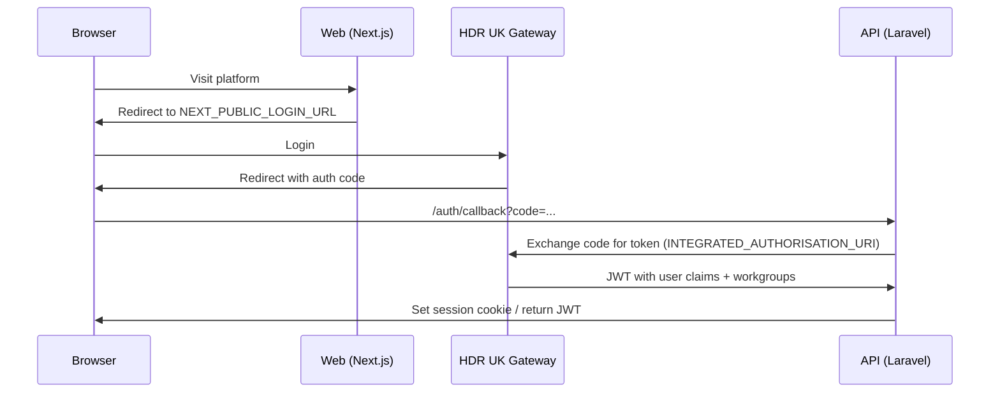

# Integrated mode

!!! warning "Integrated mode is for HDR UK only"
    Integrated mode exists to let the HDR UK Gateway issue tokens this platform trusts — it is not a general-purpose SSO mechanism and will not work with a third-party identity provider. If you are deploying the Cohort Discovery Service yourself, including if you want SSO, use [deploying your own instance](../deploying/index.md).

Integrated mode delegates authentication to the HDR UK Gateway via OAuth2. Users authenticate against the Gateway; their roles and workgroup memberships are embedded in the JWT claims the API receives.

## How it works



## Step 1: Create the OAuth client in the Gateway

In the Gateway API repo, run the Cohort Discovery seeder:

```bash
php artisan db:seed --class=CohortServiceUserSeeder
```

This outputs an OAuth `client_id` and `client_secret`. Note these — you need them for the API.

Also configure the Gateway's `.env` to point at the API service:

```dotenv
COHORT_DISCOVERY_URL=http://localhost:3000
COHORT_DISCOVERY_AUTH_URL=http://localhost:8100/auth/callback
COHORT_DISCOVERY_SERVICE_ACCOUNT=cohort-service@hdruk.ac.uk
COHORT_DISCOVERY_USE_OAUTH2=true
COHORT_DISCOVERY_ADD_TEAMS_TO_JWT=true
```

## Step 2: Configure the API service

```dotenv
APP_OPERATION_MODE=integrated

# Must match the Gateway's JWT_SECRET exactly
INTEGRATED_JWT_SECRET=the-gateway-jwt-secret

# Gateway URLs
INTEGRATED_API_URI=http://localhost:8000/api/v1/
INTEGRATED_AUTHORISATION_URI=http://localhost:8000/oauth2/token

# OAuth client from Gateway seeder (Step 1)
INTEGRATED_CLIENT_ID=<client_id>
INTEGRATED_CLIENT_SECRET=<client_secret>

# API callback URL
OAUTH_INTERNAL_REDIRECT=http://localhost:8100/auth/callback
OAUTH_PLACEHOLDER_PASSWORD=a-long-random-placeholder

# Basic auth for collection hosts
CLIENT_BASIC_AUTH_ENABLED=true
```

## Step 3: Configure the Web service

```dotenv
APPLICATION_MODE=integrated
NEXT_PUBLIC_LOGIN_URL=http://localhost:8000/login?redirect_cohort_discovery_upon_signin=http://localhost:3000
API_BASE_URL=http://localhost:8100
```

## Verifying integrated auth

```bash
# Obtain a Gateway JWT, then test the API:
curl -H "Authorization: Bearer <gateway-jwt>" \
     http://localhost:8100/api/v1/user
```

A 200 response with the user object confirms integrated auth is working.

---

