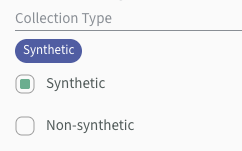

# Synthetic Data with somop

`somop` is an HDR UK-developed Python tool that generates synthetic [OMOP CDM v5.4.3](https://ohdsi.github.io/CommonDataModel/) datasets from YAML configuration files. It produces realistic-looking clinical test data — conditions, medications, measurements, procedures — without using any real patient records.

Its primary use case is standing up a local BUNNY instance with an OMOP database for end-to-end integration testing of the Cohort Discovery Service.

To get synthetic collections without running somop yourself, the [Cohort Discovery Service stack](https://hdruk.github.io/cohort-discovery-service-stack/getting-started/) starts a synthetic database and a BUNNY for each one automatically.

<div class="grid cards" markdown>

- :material-download: **Installation**

    ---
    Install somop and its Docker dependencies.

    [:octicons-arrow-right-24: Installation](installation.md)

- :material-file-cog: **Configuration**

    ---
    YAML config reference — all tables, distributions, and interaction effects.

    [:octicons-arrow-right-24: Configuration](configuration.md)

- :material-console: **CLI Reference**

    ---
    `generate`, `load`, `run`, and `multi` command details.

    [:octicons-arrow-right-24: CLI Reference](cli.md)

</div>

---

## What somop does

`somop` lets you:

- **Generate** synthetic OMOP CDM CSV files from a simple YAML config — specify concept IDs, prevalences, and value distributions
- **Load** those files into a PostgreSQL database using [omop-lite](https://github.com/health-Informatics-UoN/omop-lite) via Docker
- **Run** a full local stack — PostgreSQL + omop-lite + two BUNNY instances (type A and type B) — in a single Docker Compose command
- **Test** without Athena downloads, real data, or complex infrastructure

---

## When to use it

| Scenario | Use |
|----------|-----|
| Testing that BUNNY can pick up and execute a query end-to-end | `somop run` |
| Generating a dataset for manual inspection of OMOP schema | `somop generate` or `somop load` |
| CI integration tests for the API + BUNNY interaction | `somop run` (or `somop load` against a pre-existing DB) |
| Load testing with a large synthetic population | `somop generate` with `person.n_people: 400000` |
| Multi-site simulations | `somop multi run` |

---

## Marking a dataset as synthetic

`somop` generates the data, but it doesn't tell Cohort Discovery that the data is synthetic. You do that on the Collection: set its **Collection Type** to **Synthetic**. Do this for any Collection whose data isn't real patient records, whether it came from `somop`, another generator, or test data made during onboarding ([step D3](../../workstreams/data.md#d3-create-synthetic-data-recommended)).

<!-- TODO(DP-850): add a screenshot of the Collection Type options with Synthetic selected, e.g.  -->

1. Open the Collection's page in Cohort Discovery:
    - **New Collection:** follow [Step 5 of the Bunny setup guide](../../bunny/setup.md#step-5-create-a-data-collection). The Collection Type options become available once you have selected a **Collection Host**.
    - **Existing Collection:** select it in your organisation's **Collections** tab and click the **lock icon** to unlock the right-hand panel.
2. Under **Collection Type**, select **Synthetic**. The default is **Non-synthetic**.
3. Click **Create** (new Collection) or the **lock icon** again (existing Collection) to save.

You can change the Collection Type at any time.

### How synthetic Collections appear

Once a Collection is marked as synthetic:

- An **S** chip appears next to it, with the tooltip *"This collection has been marked as being synthetic data"*. Researchers see it in the dataset picker when choosing which Collections to query, and you see it in your organisation's **Collections** list.
- Researchers can select or clear all synthetic Collections at once with the **synthetic** filter. Synthetic Collections are listed after real ones, and depending on the user's access they may not be selected by default.
- A concept found **only** in synthetic Collections shows an **S** chip (*"This concept is only available in synthetic data"*). Concept search and free-text query search both leave these concepts out unless a synthetic Collection is selected.

---

## Prerequisites

- Python 3.9+
- Docker 24+ (required for `somop load` and `somop run`)
- A running API with a registered collection (for `somop run`)

---

## Quick example

```bash
# Install
pip install -e path/to/somop

# Spin up a full BUNNY + Postgres stack against the local API
somop run \
  --config path/to/somop/configs/conditions.yaml \
  --collection-id <collection-uuid> \
  --api-url http://host.docker.internal:8100/api/v1 \
  --api-username admin@example.com \
  --api-password yourpassword
```

Press `Ctrl+C` to stop and remove all containers.

See [Installation](installation.md) to get started, or jump straight to the [CLI Reference](cli.md) if you already have somop installed.
